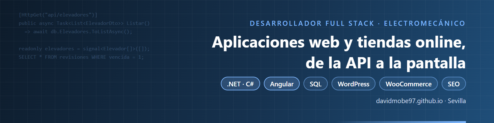

# Hola, soy David 👋

**Técnico web y electromecánico en Sevilla.** Hago webs y tiendas online con WordPress y WooCommerce, me encargo de su SEO y preparo contenido 3D para venderlas mejor.

- 🛠️ Ahora mismo llevo la web y la tienda online de [Syros Maquinaria](https://syrosmaquinaria.com), con un catálogo de más de 2.500 productos de equipamiento para talleres.
- 🎓 Tengo el Certificado de Profesionalidad **IFCD0110 – Confección y Publicación de Páginas Web** (nivel 2, 560 h).
- 💼 También trabajo como desarrollador web freelance y colaboro con NOWALIA.
- 🌱 Ahora estoy aprendiendo desarrollo de apps móviles multiplataforma y animación con código (Remotion).

## Tecnologías

**Web:** HTML5 · CSS3 · JavaScript · PHP · WordPress · WooCommerce · Elementor
**Datos:** SQL · Oracle (PL/SQL) · MySQL
**Programación:** Java SE / EE · Spring · Hibernate · Angular
**SEO:** Google Search Console · SEO técnico · redirecciones 301 · datos estructurados
**3D y vídeo:** Blender · Unreal Engine · Remotion (React)
**Móvil:** Android

## Proyectos

| Proyecto | Qué es |
|---|---|
| [Portfolio · Syros Maquinaria](https://github.com/davidmobe97/portfolio-syros-maquinaria) | Tienda online WooCommerce con más de 2.500 productos, SEO técnico y vídeos 3D de producto |
| [Botón de ficha técnica para WooCommerce](https://github.com/davidmobe97/woo-ficha-tecnica-pdf) | Plugin de ejemplo: muestra en cada producto un botón para descargar su ficha técnica en PDF |

> Gran parte de mi trabajo es para clientes, así que su código es privado. Aquí enseño el resultado y algunos ejemplos.

## Contacto

[LinkedIn](https://www.linkedin.com/in/david-molero-berrocal) · [syrosmaquinaria.com](https://syrosmaquinaria.com)
